[English](README.md) · [العربية](README.ar.md) · [简体中文](README.zh-CN.md) · [繁體中文](README.zh-TW.md) · [Čeština](README.cs.md) · [Français](README.fr.md) · [Deutsch](README.de.md) · [Ελληνικά](README.el.md) · [Bahasa Indonesia](README.id.md) · [Gaeilge](README.ga.md) · [Italiano](README.it.md) · [日本語](README.ja.md) · [한국어](README.ko.md) · [Polski](README.pl.md) · [Română](README.ro.md) · [Русский](README.ru.md) · **Español** · [Українська](README.uk.md) · [اردو](README.ur.md) · [ئۇيغۇرچە](README.ug.md) · [Tiếng Việt](README.vi.md)

  

  

## Proyectos destacados

- [FITTER-AI](https://github.com/sailxx/FITTER-AI) es un robot Telegram que estima las calorías a partir de una foto de tu comida.
- [Okto](https://github.com/sailxx/Okto) es un planificador para Android, Windows y la web, con tareas, un calendario y un temporizador de enfoque.
- [Tobi](https://github.com/sailxx/Tobi) monitorea Claude Code, Codex y Cursor en Windows 11 y le permite aprobar acciones con un solo clic.
- [TrayMixer](https://github.com/sailxx/TrayMixer) controla el volumen por aplicación desde la bandeja del sistema en Windows 11 y Linux (versión preliminar).

## Acerca de mí

Soy Vlad, un desarrollador joven y ambicioso al que le encanta la tecnología y la programación. Siempre estoy aprendiendo, perfeccionando mis habilidades y poniendo en práctica lo que aprendo. Me encontrarás en GitHub la mayoría de los días, trabajando en mis repositorios, enviando actualizaciones y experimentando con nuevas ideas.

Utilizo Windows 11 y Fedora Linux con VS Code y Android Studio. Trabajo con JavaScript, TypeScript, Kotlin, C#, HTML, CSS, JSON y SVG. Hablo ruso, inglés e italiano y disfruto del diseño, los juegos y la construcción de PC del UI.

## Contacto

[Telegram @arkhitkovv](https://t.me/arkhitkovv) · [LeetCode @sailixx](https://leetcode.com/u/sailixx/)
