<p align="center">
  
</p>

<p align="center">
  
</p>

<p align="center">
  <a href="https://leetcode.com/u/qXESYLd6R6/"></a>
</p>

```bash
> cat current-focus.txt
```

```text
Building: FITTER — a Telegram bot that counts calories and macros from a photo of your meal.
Exploring: AI products, Android apps with Kotlin and Compose, and minimal open-source tools.
```

<p align="center">
  <a href="https://github.com/sailxx/Okto"></a>
  <a href="https://github.com/sailxx/Okto-Notes"></a>
  <a href="https://github.com/sailxx/FITTER-AI"></a>
  <a href="https://github.com/sailxx/TrayMixer"></a>
  <a href="https://github.com/sailxx/Budila"></a>
  <a href="https://github.com/sailxx/Flipt"></a>
  <a href="https://github.com/sailxx/Ember"></a>
  <a href="https://github.com/sailxx/Okto-Calculator"></a>
  <a href="https://github.com/sailxx/LifeKalendar"></a>
  <a href="https://github.com/sailxx/Marks"></a>
  <a href="https://github.com/sailxx/Arhitector-AI"></a>
</p>

<p align="center">
  <a href="https://t.me/arkhitkovv"></a>
</p>
