[English](README.md) · [العربية](README.ar.md) · [简体中文](README.zh-CN.md) · [繁體中文](README.zh-TW.md) · [Čeština](README.cs.md) · [Français](README.fr.md) · [Deutsch](README.de.md) · [Ελληνικά](README.el.md) · [Bahasa Indonesia](README.id.md) · [Gaeilge](README.ga.md) · [Italiano](README.it.md) · [日本語](README.ja.md) · [한국어](README.ko.md) · [Polski](README.pl.md) · [Română](README.ro.md) · [Русский](README.ru.md) · [Español](README.es.md) · [Українська](README.uk.md) · [اردو](README.ur.md) · **ئۇيغۇرچە** · [Tiếng Việt](README.vi.md)

  

  

## ئالاھىدە تۈرلەر

- [FITTER-AI](https://github.com/sailxx/FITTER-AI) تاماقنىڭ سۈرىتىدىن ئىسسىقلىق ئېنېرگىيىسىنى مۆلچەرلەيدىغان Telegram بوت.
- [Okto](https://github.com/sailxx/Okto) Android ، Windows ۋە تورنىڭ پىلانلىغۇچىسى ، ۋەزىپە ، كالېندار ۋە فوكۇس توغرىلاش ۋاقتى بار.
- [Tobi](https://github.com/sailxx/Tobi) Windows 11 دىكى Claude Code ، Codex ۋە نۇر بەلگىسىنى نازارەت قىلىدۇ ۋە بىر چېكىش ئارقىلىق ھەرىكەتلەرنى تەستىقلىيالايسىز.
- [TrayMixer](https://github.com/sailxx/TrayMixer) Windows 11 ۋە Linux (ئالدىن كۆرۈش) دىكى سىستېما تەخسىدىن ھەر بىر دېتالنىڭ مىقدارىنى كونترول قىلىدۇ.

## مەن ھەققىدە

مەن ۋىللاد ، ياش ، ئۇلۇغۋار پروگرامما ئاچقۇچى ، ئۇ تېخنىكا ۋە پروگرامما تۈزۈشنى ياخشى كۆرىدۇ. مەن ھەمىشە ئۆگىنىمەن ، ماھارىتىمنى ئۆتكۈرلەشتۈرىمەن ۋە ئۆگەنگەنلىرىمنى ئەمەلىيەتتە كۆرسىتىمەن. سىز مېنى كۆپىنچە كۈنلەردە GitHub دىن تاپالايسىز ، ئامبىرىمدا ئىشلەۋاتىمەن ، توشۇش يېڭىلانمىلىرى ۋە يېڭى ئىدىيىلەرنى سىناق قىلىۋاتىمەن.

مەن Windows 11 ۋە Fedora Linux نى VS كودى ۋە Android ستۇدىيىسى بىلەن ئىشلىتىمەن. مەن JavaScript ، TypeScript ، Kotlin, C #, HTML, CSS, JSON ۋە SVG بىلەن ئىشلەيمەن. مەن رۇسچە ، ئىنگلىزچە ۋە ئىتالىيەچە سۆزلەيمەن ، مەن UI لايىھىلەش ، ئويۇن ۋە كومپيۇتېر ياساشتىن ھۇزۇرلىنىمەن.

## ئالاقىلىشىڭ

[Telegram @arkhitkovv](https://t.me/arkhitkovv) · [LeetCode @sailixx](https://leetcode.com/u/sailixx/)
